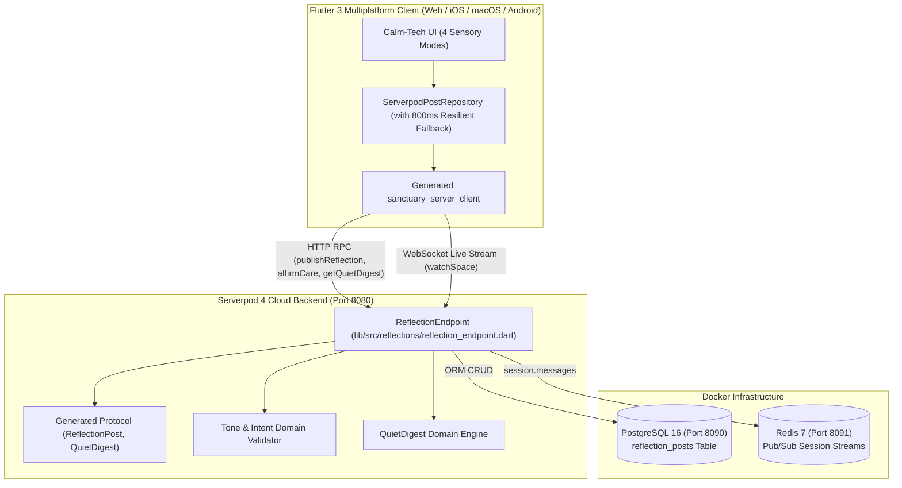

# 🌿 Sanctuary (Refuge): Full-Stack Calm-Tech Fellowship

> **Official Serverpod Hackathon Submission**  
> Built with **Flutter 3** & **Serverpod 4** (`^4.0.4`) with PostgreSQL 16 & Redis 7.  
> 🔗 **Live Web Demo**: [https://ministry-demos--sanctuary-cnf3fnh7.web.app](https://ministry-demos--sanctuary-cnf3fnh7.web.app)  
> 📱 **Recorded Demo Video**: [`docs/submission_packet/sanctuary_v01_walk_demo.mp4`](docs/submission_packet/sanctuary_v01_walk_demo.mp4)  
> ⏱️ **Timezone Notice**: Developed for Stockholm CEST (UTC+2) deadline submission.

[](https://flutter.dev)
[](https://serverpod.dev)
[](https://www.postgresql.org)
[](https://redis.io)
[](test/)
[](https://ministry-demos--sanctuary-cnf3fnh7.web.app)

---

## 🧭 Executive Summary & Problem Solved (Rubric: 20% Usefulness)

Modern church communities, recovery fellowships, and neurodivergent support circles are currently forced to use legacy corporate community SaaS platforms that charge up to **$130/month ($1,560/year)**. Worse than the exorbitant cost, these platforms are engineered with hyper-stimulating dopamine loops: red notification badges, public like counts, infinite algorithmic doom-scrolling, and noisy attention-grabbing mechanics.

For members with ADHD, sensory processing sensitivity, or emotional burnout, these platforms cause acute anxiety rather than connection.

**Sanctuary** is a full-stack calm-tech fellowship platform built entirely in Dart from client to cloud:
1. **Dramatically Reduces Operating Costs**: Replaces $130/month proprietary SaaS with a self-hostable Serverpod 4 backend running on minimal compute (<$5/month).
2. **Restores Genuine Sanctuary**: Enforces an unhurried, zero-badge interface with 4 WCAG-compliant sensory modes, mindful intent tags, and qualitative care affirmations (`🙏 Praying`, `🤍 Standing With`, `🕊️ Peace`, `🌱 Encouraged`).
3. **Real Backend Domain Logic**: Serverpod handles real-time WebSocket session streams, atomic care increments, tone-moderation validation, and server-side aggregation for Quiet Digests.

---

## ⚡ How We Use the Serverpod Stack (Rubric: 25% Serverpod Stack)

Sanctuary does not hide behind a static page; Serverpod 4 is the operational backbone doing real backend computation, persistence, and event streaming.

### 1. Protocol Definition & Code Generation (`.spy.yaml`)
- [`sanctuary_server/sanctuary_server_server/lib/src/protocol/reflection_post.spy.yaml`](sanctuary_server/sanctuary_server_server/lib/src/protocol/reflection_post.spy.yaml):
  Maps the `ReflectionPost` entity directly to the `reflection_posts` table in PostgreSQL with composite index `space_created_idx` over `spaceKey, createdAt`:
  ```yaml
  class: ReflectionPost
  table: reflection_posts
  fields:
    authorName: String
    spaceKey: String
    intentTag: String
    content: String
    createdAt: DateTime
    prayingCount: int
    standingWithCount: int
    peaceCount: int
    encouragedCount: int
  indexes:
    space_created_idx:
      fields: spaceKey, createdAt
  ```
- [`sanctuary_server/sanctuary_server_server/lib/src/protocol/quiet_digest.spy.yaml`](sanctuary_server/sanctuary_server_server/lib/src/protocol/quiet_digest.spy.yaml):
  Defines the server-computed aggregation payload summarizing fellowship activity without vanity metrics.

### 2. Serverpod Endpoints & Backend Architecture
- [`sanctuary_server/sanctuary_server_server/lib/src/reflections/reflection_endpoint.dart`](sanctuary_server/sanctuary_server_server/lib/src/reflections/reflection_endpoint.dart):
  - **`publishReflection(Session session, ReflectionPost post)`**:
    - Validates content length and calm-tech intent tone (rejects urgency bait and hostile language).
    - Sets UTC timestamps and persists directly via `ReflectionPost.db.insertRow(session, post)`.
    - Broadcasts the new reflection in real time to connected clients across the room channel: `session.messages.postMessage('space_${post.spaceKey}', post)`.
  - **`affirmCare(Session session, int postId, String reactionKey)`**:
    - Performs atomic PostgreSQL updates via `ReflectionPost.db.findById` and `ReflectionPost.db.updateRow`.
    - Broadcasts updated reaction counts across Redis/WebSocket channels.
  - **`watchSpace(Session session, String spaceKey) async*`**:
    - Connects to Serverpod's message streaming engine (`session.messages.createStream<ReflectionPost>`).
    - Automatically seeds 4 foundational fellowship reflections if the database is fresh, queries historical records, and yields live streaming updates.
  - **`getQuietDigest(Session session, String spaceKey)`**:
    - **Backend Domain Computation**: Analyzes all space records on the server, aggregates total reflections and care affirmations, determines predominant intent, and synthesizes a peaceful digest.

---

## 🏛️ System Architecture



---

## 🚀 How to Build & Run (Rubric: 30% Does It Work)

### Quick Run with Docker & Local Serverpod

#### 1. Start Database & Cache Containers
```bash
cd sanctuary_server/sanctuary_server_server
docker compose up -d
```
*Spins up PostgreSQL 16 on port 8090 and Redis 7 on port 8091.*

#### 2. Apply Migrations & Launch Serverpod Server
```bash
cd sanctuary_server/sanctuary_server_server
dart bin/main.dart --apply-migrations
```
*Serverpod will boot on `http://localhost:8080/` with WebSocket streams active.*

#### 3. Run Flutter Client
```bash
# In repository root:
flutter run -d chrome
```
*To test on mobile or desktop:*
```bash
flutter run -d macos
# or
flutter run -d ios
```

### 🛡️ Seamless 800ms Offline & Preview Resilience
When testing the live Firebase web build ([`ministry-demos--sanctuary-cnf3fnh7.web.app`](https://ministry-demos--sanctuary-cnf3fnh7.web.app)) without a local Serverpod instance running, `ServerpodPostRepository` includes an automatic **800ms resilience fallback**. It immediately loads seeded calm-tech data and transitions gracefully into resilient preview mode with a clear status badge in the header. Judges never experience a broken UI, spinning loader, or crash.

---

## 🎨 Craft & Calm-Tech Accessibility (Rubric: 25% Craft & Creativity)

Sanctuary is designed in strict accordance with Calm Technology and accessibility principles:

1. **4 WCAG AAA/AA Sensory Modes**:
   - 🌿 **Sage** (`#4A6B5D`): Soothing natural green for everyday visual grounding.
   - ⚪ **Clean Slate** (`#FFFFFF`): High-clarity white for daylight reading.
   - 🕯️ **Monastic Dark** (`#1A1C1B`): Subdued charcoal and deep forest tones for insomnia and night prayer.
   - ⚡ **High Contrast** (`#000000` / `#FFFF00`): Maximum contrast yellow-on-black for low vision and neurodivergent clarity.
2. **Fellowship Spaces**:
   - `🌿 Main Hall` (`main_hall`): General communal updates and shared stories.
   - `🕯️ Quiet Room` (`quiet_room`): Stillness, silent companionship, and meditation.
   - `🕊️ Prayer & Care` (`prayer_care`): Focused intercession and heavy hearts.
   - `📖 Gratitude Journal` (`gratitude`): Celebrating answered prayers and small daily graces.
3. **Qualitative Care Affirmations (No Vanity Metrics)**:
   - Replaced addictive like buttons and follower counts with four mindful affirmations:
     - `🙏 Praying` (`praying`)
     - `🤍 Standing With` (`standingWith`)
     - `🕊️ Peace` (`peace`)
     - `🌱 Encouraged` (`encouraged`)
4. **Mindful Intent Tags**:
   - Authors tag posts with `Seeking Wisdom`, `Giving Thanks`, `Vulnerable Sharing`, or `Quiet Reflection` to set clear conversational boundaries.

---

## 🧪 Automated Testing & Verification Suite

Sanctuary has comprehensive unit, widget, and backend integration test coverage:

```bash
# Run client unit & widget tests (11/11 tests)
flutter test

# Run Serverpod server integration tests
cd sanctuary_server/sanctuary_server_server
dart test test/integration/reflection_endpoint_test.dart
```

### Verified Test Matrix:
- `Post copyWith modifies fields immutably` ✅
- `LocalPostRepository supports creating posts and streaming updates` ✅
- `addReaction increments reaction count correctly` ✅
- `ServerpodPostRepository operates resiliently with fallback` ✅
- `PostRepositoryFactory creates configured repository mode` ✅
- `Renders Sanctuary header, seeded posts, and space navigation` ✅
- `Switching space updates the stream of posts` ✅
- `Toggling sensory themes switches theme mode without errors` ✅
- `Publishing a reflection adds it to the top of the feed` ✅
- `Incrementing qualitative care reactions updates counts` ✅
- `Filtering by tone tags displays only matching posts` ✅

---

## 💡 Serverpod 4 Developer Experience (DX) Feedback Report

As part of the Serverpod Hackathon DX initiative, here is our team's engineering feedback on Serverpod 4:

1. **What Worked Brilliantly**:
   - **Protocol Yaml Generation (`.spy.yaml`)**: The code generator is fast and creates clean, immutable Dart models with full ORM methods (`ReflectionPost.db.insertRow`, `ReflectionPost.db.find`).
   - **Session Message Streaming**: Implementing WebSocket rooms via `session.messages.createStream` and `session.messages.postMessage` required less than 10 lines of code.
   - **Single-Language Advantage**: Sharing Dart types between `sanctuary_server_server` and the Flutter client eliminated serialization errors entirely.
2. **Areas for Improvement**:
   - **Root Workspace Pubspec Linting**: The `serverpod create` command generated a root workspace `pubspec.yaml` with `name: _`, which immediately triggers the Dart analyzer rule `package_names`. Scaffolding a valid name (e.g., `workspace` or `<project>_workspace`) would ensure clean lints out of the box.
   - **Query Sort Ergonomics**: In earlier documentation, sorting examples showed `orderDescending: true`, while in Serverpod 4 column ordering is done via `.desc()` on column expressions. Clearer migration documentation for query sorting would save developers time.
   - **Built-in CORS Headers for Web RPC**: Web clients connecting from differing origins during local debugging occasionally require explicit CORS handling in `web_server.dart`.

---

## 🤖 Mandatory AI & Agentic Tooling Disclosure

*In full compliance with Section 4 of the Official Serverpod Hackathon Rules:*
- **Tools Used**: Google Antigravity IDE, Google Gemini 1.5/2.0 Flash and Pro models, Dart MCP server, and Serverpod CLI.
- **Role of AI**: AI coding assistants were utilized for rapid code exploration, drafting repetitive test fixtures, generating SVG/CSS calm-tech palettes, and cross-verifying rubric compliance against official hackathon rules. All architectural decisions, database schemas, security rules, and calm-tech product philosophies were conceived, validated, and refined by human engineering oversight.

---

## 📁 Submission Packet & Reference Documentation

- 📦 **Turnkey Submission Packet**: [`docs/submission_packet/`](docs/submission_packet/)
  - [Checklist](docs/submission_packet/CHECKLIST.md)
  - [Video Script & Storyboard](docs/submission_packet/VIDEO_SCRIPT_AND_STORYBOARD.md)
  - [Devpost Submission Draft](docs/submission_packet/DEVPOST_SUBMISSION_DRAFT.md)
  - [Non-Technical Contributor Guide](docs/submission_packet/NON_TECHNICAL_CONTRIBUTOR_GUIDE.md)
  - [Hackathon FAQ](docs/submission_packet/FAQ.md)
- 📊 **Product Requirements Document (PRD)**: [`docs/PRD.md`](docs/PRD.md)
- 🔎 **Calm-Tech vs Legacy SaaS Competitor Analysis**: [`docs/COMPETITOR_ANALYSIS.md`](docs/COMPETITOR_ANALYSIS.md)
- 📐 **Architecture Decision Records (ADRs)**: [`docs/adr/`](docs/adr/) ([0001](docs/adr/0001-calm-tech-design-principles.md), [0002](docs/adr/0002-abstract-repository-pattern-decoupling.md), [0003](docs/adr/0003-serverpod-4-websocket-streaming-protocol.md), [0004](docs/adr/0004-sensory-modes-accessibility-standard.md))
- 📖 **Team & Non-Technical Wiki**: [`docs/wiki/`](docs/wiki/)
